# Guía de uso

## Roles

| Rol | Qué puede hacer |
|---|---|
| Cliente | Consulta el menú de cada sucursal y las reseñas de los platillos, califica los platillos que pidió, reserva una mesa y consulta sus reservaciones, hace pedidos para llevar (pago, seguimiento y cancelación), ve sus notificaciones (pedido listo, confirmación, cambios y recordatorio de reservaciones). |
| Mesero | Ve las mesas de su sucursal con su pedido abierto, toma pedidos de mesa y agrega, cambia o quita platillos mientras el pedido está abierto. Ve los platillos listos de sus mesas y los marca como entregados. |
| Cocina | Ve los pedidos pendientes de su sucursal en un tablero en tiempo real y marca cada platillo como listo. |
| Gerente | Administra el menú de su sucursal (crear, editar, habilitar y deshabilitar platillos, subir su imagen), gestión de categorías, consulta el tablero de cocina, consulta el reporte de calificaciones de su sucursal, ver ocupacion de las mesas de sucursales, modera (oculta) reseñas inapropiadas, controla el inventario de insumos de su sucursal (entradas, salidas e historial), recibe alertas de insumos por agotarse y consulta el dashboard de ventas de su sucursal. |
| Gerente general | Consulta el dashboard de ventas de todas las sucursales (resumen, detalle y exportación a CSV), compara el desempeño entre sucursales y consulta el tablero de cocina. |

Las visitas sin sesión pueden ver el menú y consultar la disponibilidad de mesas. Reservar o pedir exige iniciar sesión.

## Flujos principales

### Menú

#### Consultar el menú de una sucursal (cliente o visita)

1. Entrar a **Menú**.
2. Elegir la sucursal en el selector.
3. Revisar las categorías, los platillos con su precio y disponibilidad, y las reseñas de cada platillo.

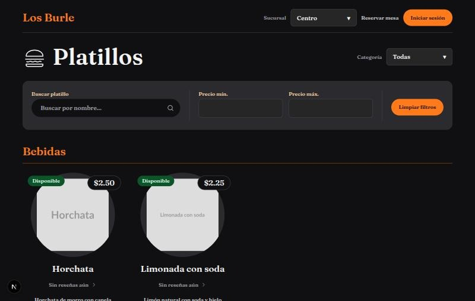

#### Gestionar platillos (gerente)

1. Iniciar sesión como gerente y abrir la gestión de platillos de la sucursal.
2. Crear un platillo con nombre, descripción, categoría, precio, disponibilidad e imagen (JPG o PNG, máximo 2 MB).
3. Editarlo cuando haga falta; un platillo deshabilitado también se puede editar.
4. Deshabilitarlo o habilitarlo: el cambio afecta solo a la sucursal del gerente.

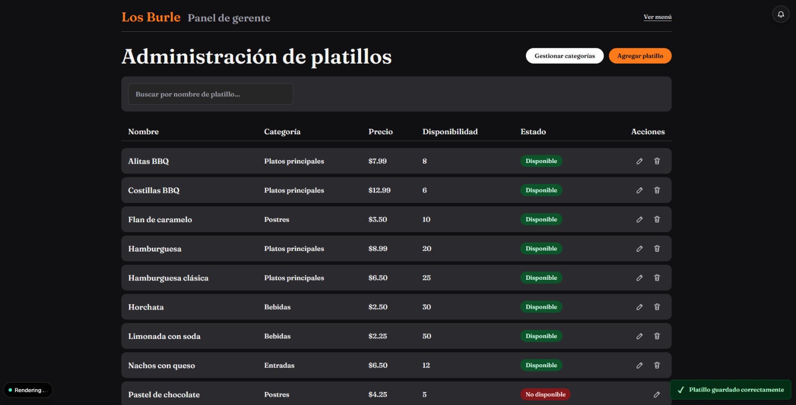
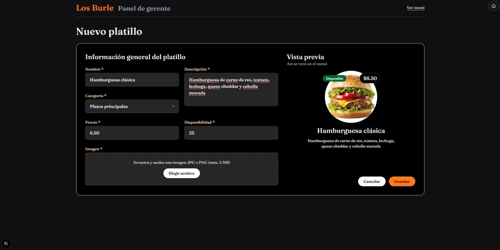

#### Gestionar categorías (gerente)

1. Abrir **Categorías**.
2. Crear una categoría o renombrarla.
3. Cambiar la categoría de un platillo de su sucursal.
4. Deshabilitar una categoría solo si no tiene platillos activos.

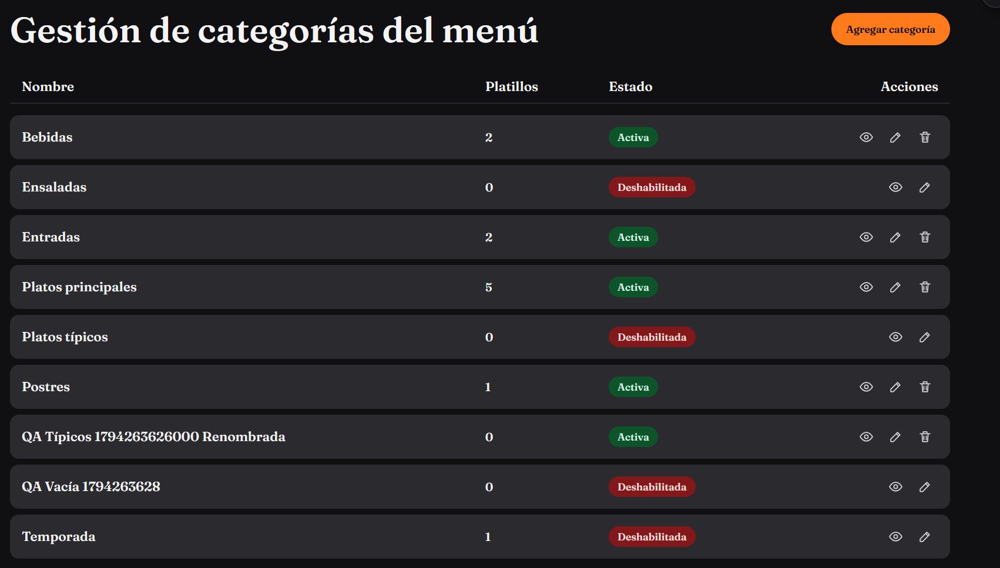

### Pedidos

#### Tomar un pedido de mesa (mesero)

1. Iniciar sesión como mesero y abrir el mapa de mesas.
2. Elegir una mesa y agregar platillos con cantidad y nota.
3. Enviar el pedido a cocina. La disponibilidad se descuenta al instante.
4. Mientras el pedido siga abierto, cambiar cantidades o quitar platillos; la disponibilidad se devuelve.

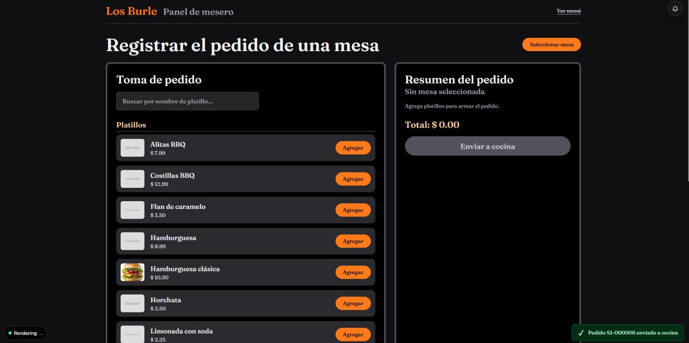
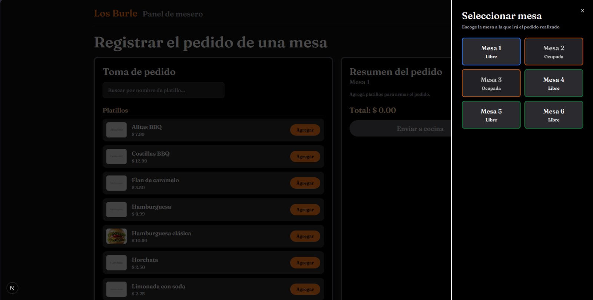

#### Pedir para llevar (cliente)

1. Iniciar sesión como cliente y armar el carrito desde el menú.
2. Elegir **Confirmar y pagar**.
3. Seguir el estado del pedido en **Mis pedidos**.
4. Cancelar el pedido mientras esté en estado Recibido: se reembolsa el pago y se devuelve la disponibilidad.

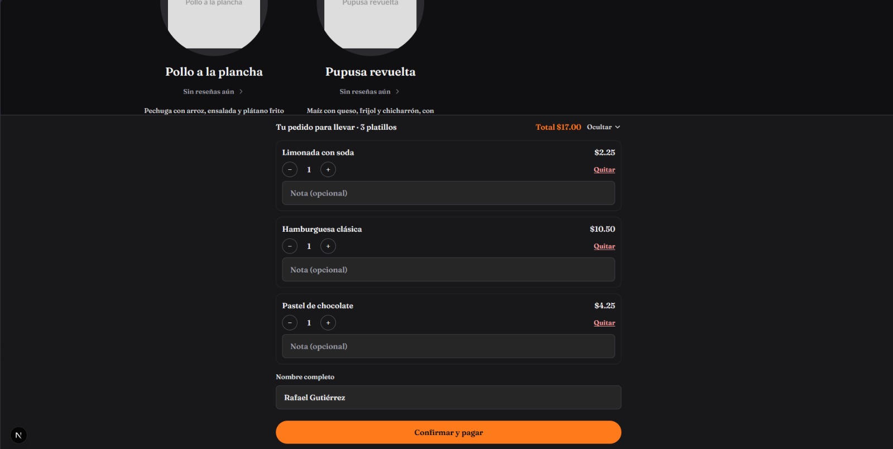
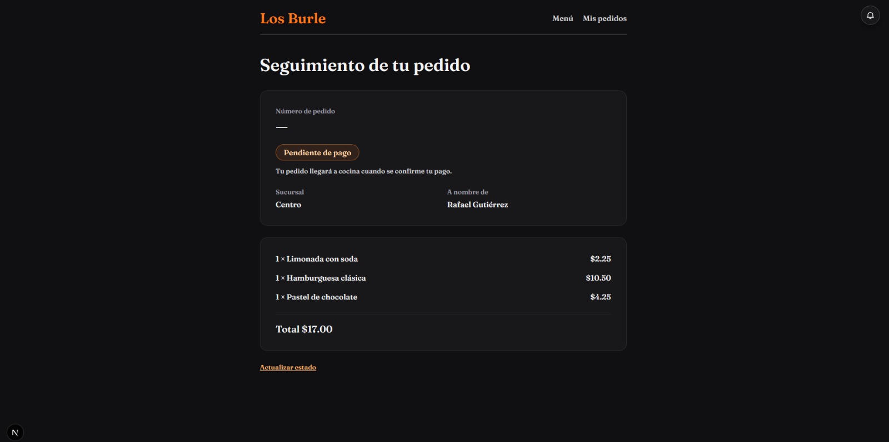
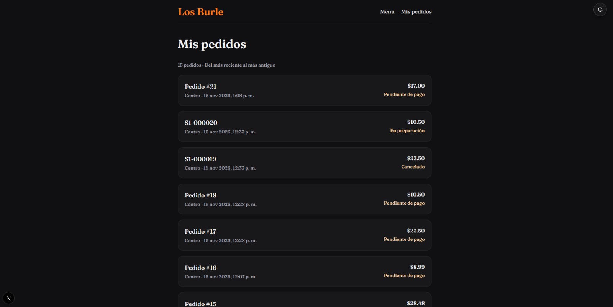

### Cocina

#### Preparar pedidos (cocina)

1. Iniciar sesión como cocina. El tablero muestra los pedidos pendientes de su sucursal, los más antiguos primero, con número, mesa o "Para llevar", hora de llegada, platillos, cantidades y notas.
2. El tablero se actualiza solo en tiempo real: los pedidos nuevos aparecen sin recargar y los que llevan más de 15 minutos de espera se resaltan. Si se pierde la conexión muestra "Reconectando…" y, al volver, recarga la lista completa.
3. Al terminar un platillo, tocar **Listo**: el platillo queda marcado y ya no se puede volver a pulsar. Cuando todos los platillos del pedido están listos, la tarjeta sale del tablero.
4. Si otra persona ya había marcado el platillo, el tablero solo lo actualiza, sin mostrar error.

#### Entregar platillos en la mesa (mesero)

1. Iniciar sesión como mesero y abrir **Por entregar** (en el encabezado o en el panel del mesero).
2. La pantalla muestra los platillos listos de las mesas de su sucursal, agrupados por mesa, con platillo, cantidad y hora en que quedó listo.
3. Al llevar un platillo a la mesa, tocar **Entregado**: desaparece de la lista sin recargar y queda registrado quién lo entregó y cuándo.
4. Cuando se entrega el último platillo de un pedido, el pedido pasa a Entregado.
5. Si la lista está vacía se muestra "No hay platillos por entregar"; si falla la carga, "No pudimos cargar los platillos" con el botón **Reintentar**.

### Inventario

#### Controlar el inventario de insumos (gerente)

1. Iniciar sesión como gerente y abrir **Inventario**.
2. La tabla muestra cada insumo con nombre, unidad, cantidad actual, cantidad mínima y la etiqueta **Normal** o **Bajo** (un insumo está bajo cuando su cantidad es igual o menor al mínimo). Los insumos bajos aparecen primero.
3. Escribir parte de un nombre en el buscador filtra la lista.
4. **Nuevo insumo**: registrar nombre, unidad (lb, kg, l o unidad) y cantidad mínima. Empieza con cantidad 0. No se permiten dos insumos con el mismo nombre en la sucursal.
5. **Registrar movimiento**: elegir Entrada o Salida, la cantidad y el motivo. La cantidad de la fila se actualiza al instante. Una salida mayor a la existencia se rechaza con "La salida supera la existencia actual" y una cantidad de 0 o negativa con "Ingresa una cantidad mayor a 0."
6. **Ver historial**: muestra los movimientos del insumo, del más reciente al más antiguo, con fecha, hora, usuario, tipo, cantidad y motivo, paginados.

#### Alertas de insumos por agotarse (gerente)

1. Cuando un movimiento deja un insumo en su mínimo o por debajo, se genera una alerta y llega un aviso "Insumo por agotarse" a los gerentes de la sucursal (en la campana y por correo).
2. El menú muestra un contador con las alertas activas; se actualiza cada 60 segundos y justo después de registrar un movimiento.
3. En **Inventario › Alertas** se ven las alertas sin resolver: las activas en negrita y las vistas en texto normal. **Marcar como vista** la deja de contar como nueva, pero sigue en la lista.
4. Más salidas mientras el insumo sigue bajo no generan otra alerta. Cuando una entrada deja el insumo por encima del mínimo, la alerta se resuelve sola y sale de la lista.
5. El enlace de cada alerta abre el insumo en la pantalla de inventario.

### Reservaciones

#### Reservar una mesa (cliente)

1. Entrar a **Reservas** y elegir sucursal, fecha, hora y número de personas.
2. Elegir una de las mesas disponibles; la reservación dura 2 horas.
3. Consultar o revisar sus reservaciones en **Mis reservaciones**.

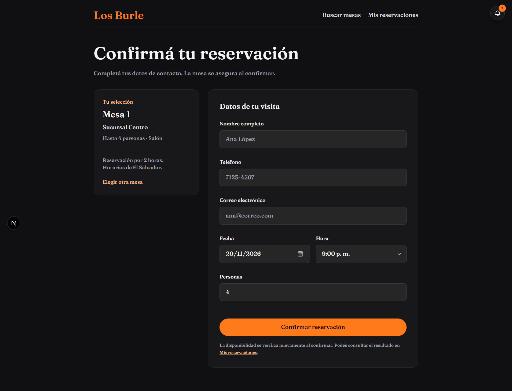
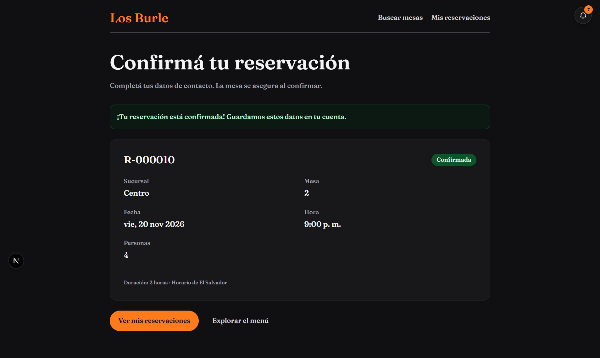
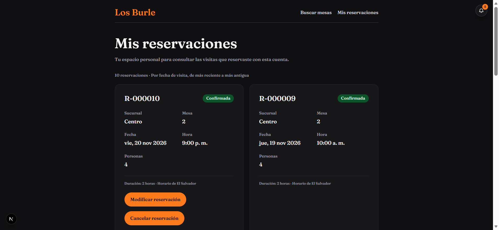

#### Modificar reserva (cliente)
1. Entrar a **Mis reservaciones**
2. Tener una reservacion a fecha futura
3. Hacer clic al botón de modificar 
4. Completar el formulario de modificación de la reserva

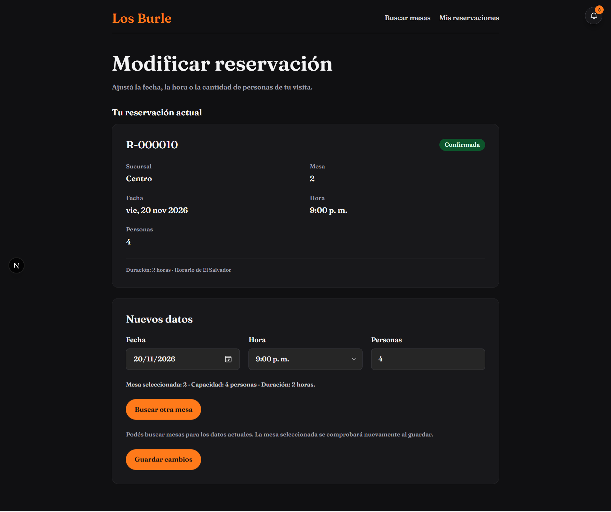

#### Cancelar reserva (cliente)
1. Entrar a **Mis reservaciones**
2. Tener una reservacion a fecha futura
3. Hacer clic en cancelar
4. Confirmar la cancelación

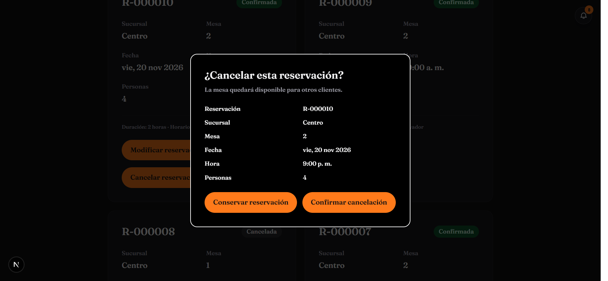
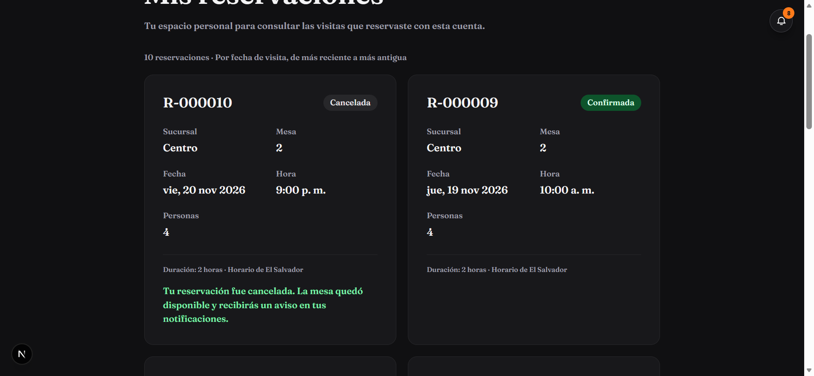

### Dashboard

Solo cuentan como venta los pedidos con pago confirmado (subtotal menos descuentos, sin IVA ni propina); los reembolsados no cuentan. Las fechas son días completos en hora de El Salvador. Los clientes, meseros y cocina no tienen acceso al dashboard.

#### Consultar las ventas (gerente general y gerente)

1. Iniciar sesión como gerente general o gerente y abrir **Dashboard**. El gerente general ve todas las sucursales o la que elija; el gerente de sucursal solo ve la suya.
2. Elegir el periodo: **Hoy**, **Semana** (desde el lunes), **Mes** (desde el día 1) o **Personalizado** (rango de fechas; la fecha final no puede ser anterior a la inicial). El gerente general puede filtrar por sucursal o dejar **Todas**. **Limpiar filtros** vuelve a Mes y Todas.
3. Revisar las ventas totales, los pedidos y el ticket promedio, y la tabla **Ventas por sucursal** con la fila Total general.

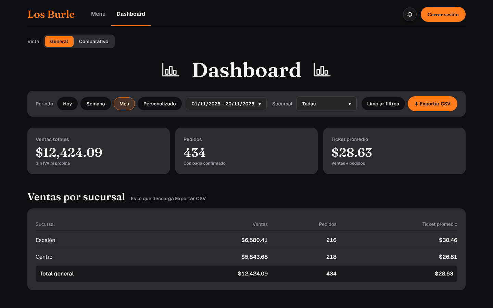

4. Revisar los **Platillos más vendidos** (los 10 primeros, con **Ver todos**) y los **Horarios pico** por franja de una hora, filtrables por día de la semana. En cada sucursal se marcan las 3 franjas con más ventas.

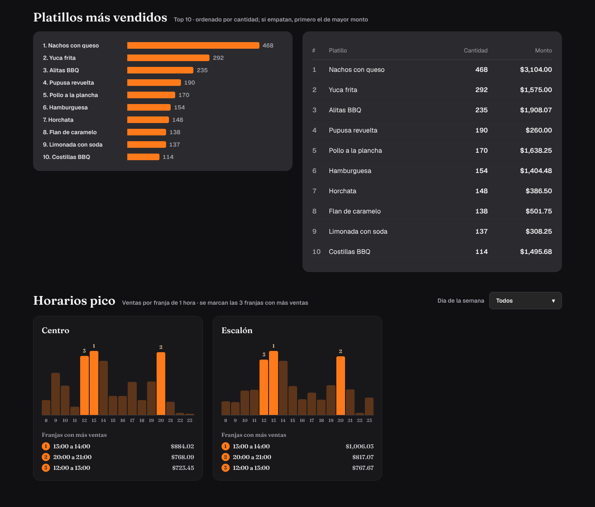

5. En **Ventas confirmadas**, revisar cada pedido del periodo (fecha, hora, sucursal, tipo, artículos, subtotal, descuentos y venta), 20 por página, del más reciente al más antiguo.
6. **Exportar CSV** descarga una fila por sucursal (ventas, pedidos y ticket promedio) y al final el Total general.

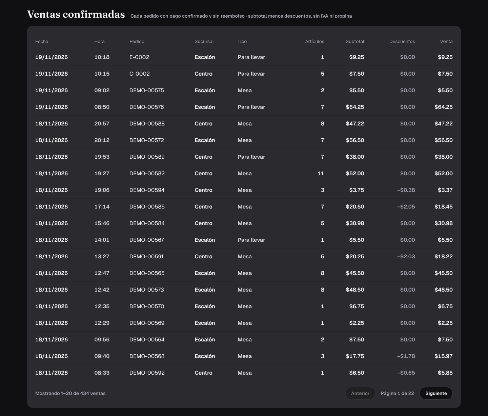

#### Comparar el desempeño entre sucursales (gerente general)

1. En el Dashboard, cambiar la **Vista** a **Comparativo**. Se conserva el periodo elegido.
2. Elegir las sucursales a comparar. Por defecto están todas marcadas y hay que dejar al menos dos; si no, se muestra "Selecciona al menos dos sucursales para comparar".

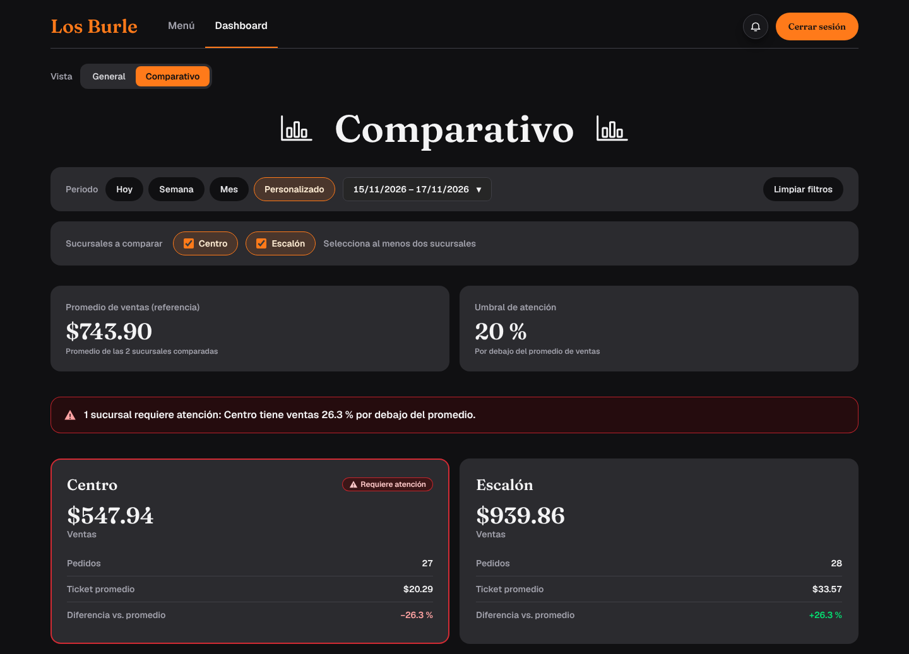
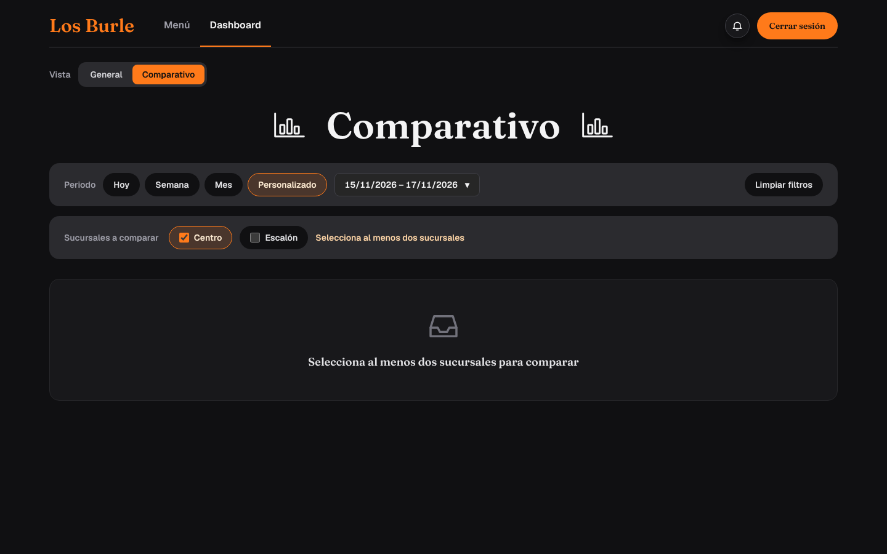

3. Cada sucursal muestra sus ventas, pedidos, ticket promedio y la diferencia contra el promedio de las sucursales comparadas. Las que venden más de 20 % por debajo del promedio se marcan **Requiere atención** y se listan en el aviso superior; si ninguna lo está, se muestra "Ninguna sucursal requiere atención en este periodo".
4. Revisar el gráfico **Ventas por sucursal vs. promedio**, con la línea del promedio y la del umbral de atención, y la tabla **Detalle**, que se ordena al hacer clic en el encabezado de una columna.
5. Si no hubo ventas en el periodo, se muestra "Sin ventas en el periodo seleccionado".

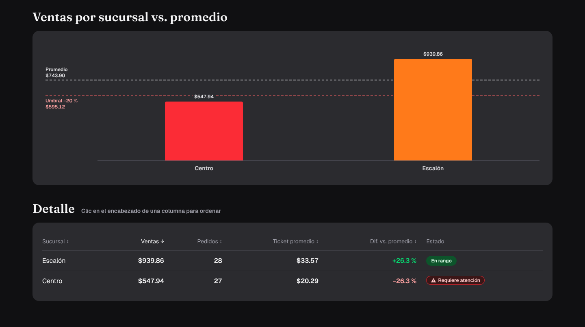

### Reseñas y calificaciones

#### Consultar las reseñas de un platillo (cliente o visita)

1. En el **Menú**, cada platillo muestra su promedio de estrellas con un decimal y el total de reseñas, o "Sin reseñas aún".
2. Tocar el promedio abre el panel de reseñas: resumen con el promedio, la distribución de 1 a 5 estrellas y la lista de reseñas visibles, de la más reciente a la más antigua, 10 por página.
3. Cada reseña muestra las estrellas, el comentario, la fecha y el nombre del cliente abreviado (por ejemplo "Ana L."). Las reseñas ocultas por el gerente no aparecen ni cuentan en el promedio.

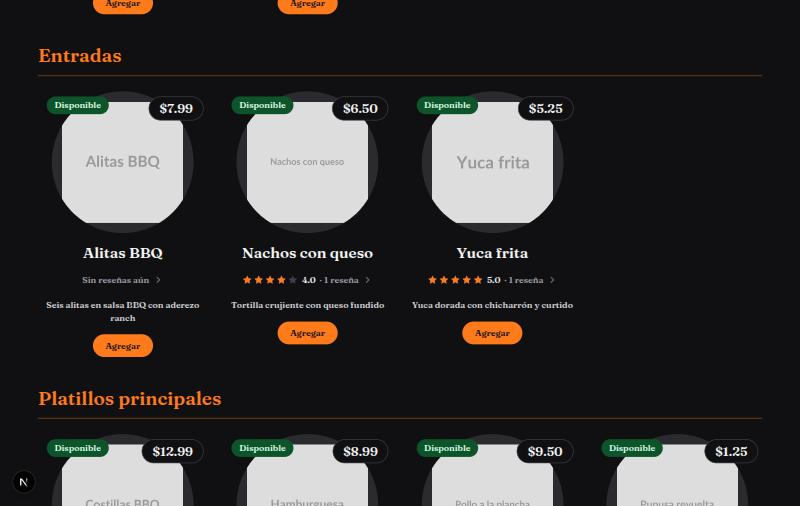

#### Calificar un platillo que pedí (cliente)

1. Abrir **Mis pedidos**. Arriba aparece **Califica lo que pediste** con los platillos de pedidos pagados en los últimos 7 días que todavía no tienen reseña.
2. Elegir **Calificar** en un platillo, marcar de 1 a 5 estrellas y, si se quiere, escribir un comentario (máximo 500 caracteres, con contador).
3. **Publicar reseña**: se muestra "Reseña publicada correctamente" y el platillo sale de la lista. Cada platillo se califica una sola vez por pedido.

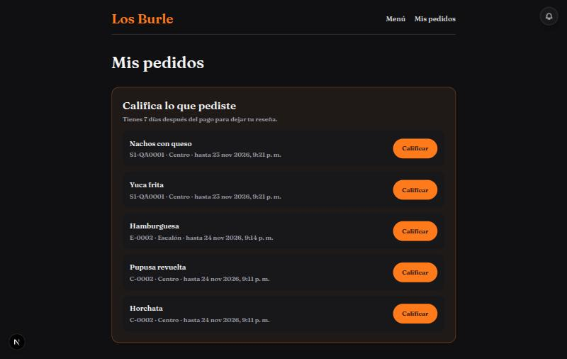
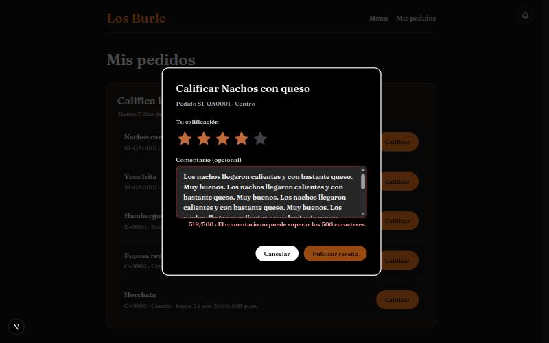
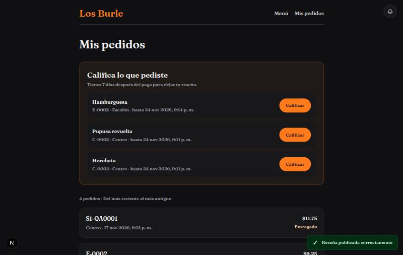

#### Consultar el reporte de calificaciones (gerente)

1. Iniciar sesión como gerente y abrir **Calificaciones** en el encabezado.
2. Revisar el promedio de la sucursal con un decimal, el total de reseñas y la cantidad de reseñas de 1 a 5 estrellas.
3. Filtrar por un rango de fechas (incluye todo el día final). Si la fecha final es anterior a la inicial se muestra "La fecha final no puede ser anterior a la inicial."; si no hay reseñas en el periodo, "Sin reseñas en el periodo seleccionado".

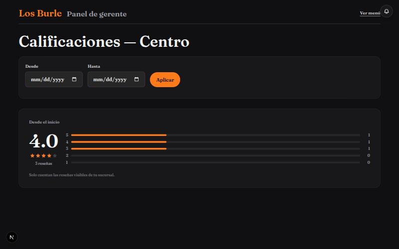
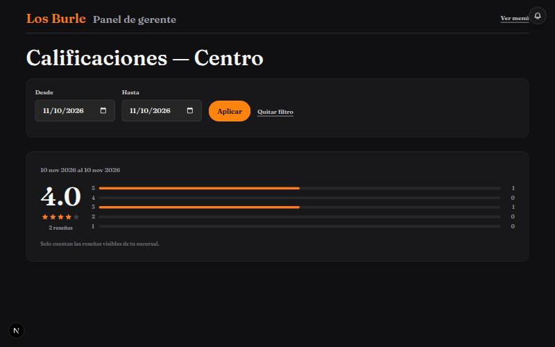

#### Moderar reseñas (gerente)

1. Abrir **Moderar reseñas** en el encabezado. Se listan las reseñas de la sucursal, de la más reciente a la más antigua, 10 por página, con platillo, estrellas, comentario, fecha y estado.
2. Filtrar por **Todas**, **Visibles** u **Ocultas**.
3. En una reseña visible, elegir **Ocultar**, escoger el motivo (Ofensivo, Spam o No relacionado) y **Confirmar** (queda deshabilitado hasta elegir un motivo). Se muestra "Reseña ocultada"; la reseña deja de verse en el menú y de contar en el promedio.
4. Las reseñas ocultas muestran quién las ocultó, la fecha, la hora y el motivo. Si otra persona ya la había ocultado, se muestra "Esta reseña ya estaba oculta."

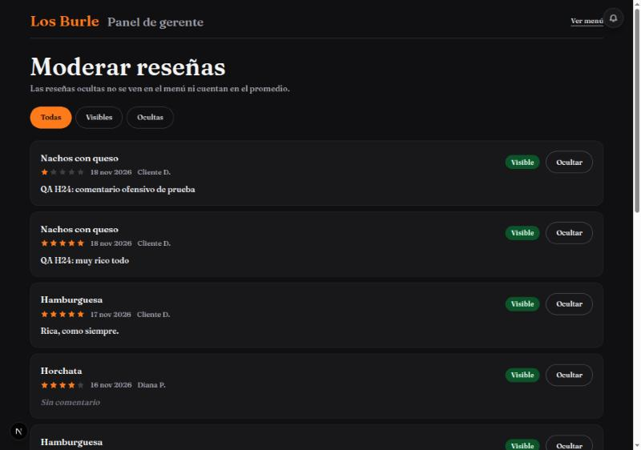
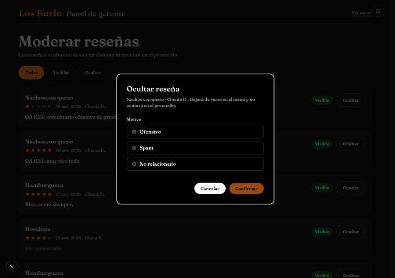
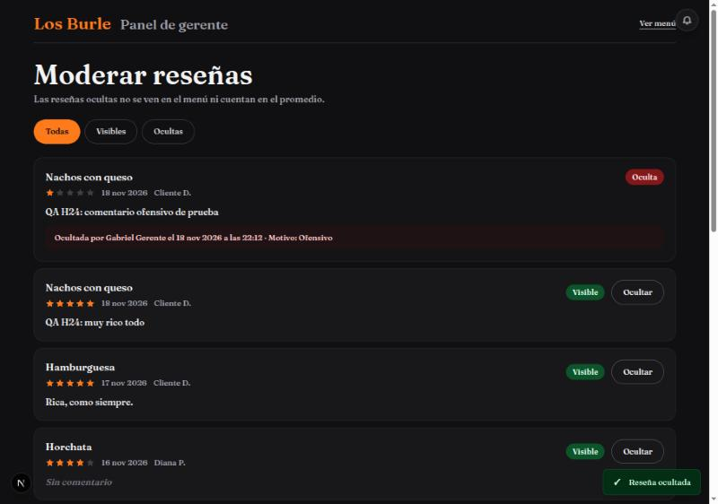
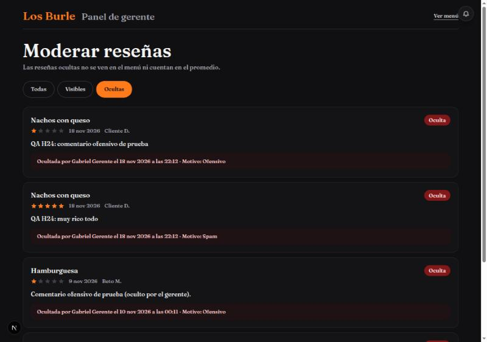

### Notificaciones

La campana del encabezado muestra cuántas notificaciones sin leer tiene el usuario y, al abrirla, su historial de la más reciente a la más antigua con título, mensaje, módulo y fecha. Al abrir una notificación se marca como leída y, si tiene enlace, lleva a la pantalla relacionada. El contador se actualiza solo cada 30 segundos mientras hay sesión y la pestaña está visible.

#### Aviso de pedido para llevar listo (cliente)

1. Cuando cocina marca listo el último platillo de un pedido para llevar, el cliente recibe "Tu pedido está listo" con el número de pedido y la sucursal.
2. Al tocar el aviso se abre el seguimiento del pedido, que ya muestra el estado Listo.

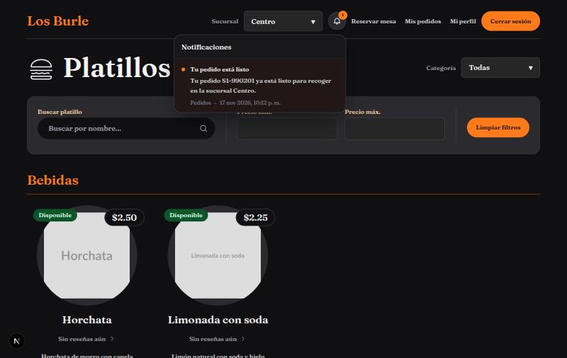
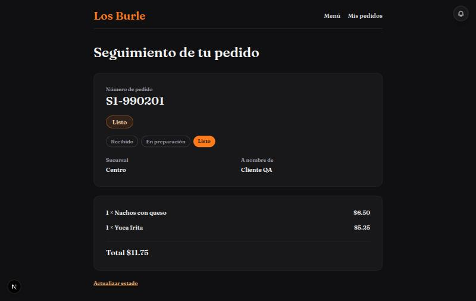

#### Avisos de reservación (cliente)

1. Al reservar, modificar o cancelar una mesa, el cliente recibe "Reservación confirmada", "Reservación modificada" o "Reservación cancelada" con el código, la fecha, la hora, las personas, la sucursal y la mesa.
2. Dos horas antes de la reservación llega "Recordatorio de tu reservación". Si la reservación se hizo o se cambió con menos de 2 horas de anticipación, solo llega la confirmación.
3. Al tocar el aviso se abre **Mis reservaciones** con esa reservación resaltada. Si la sesión expiró, después del login se vuelve a la misma reservación.

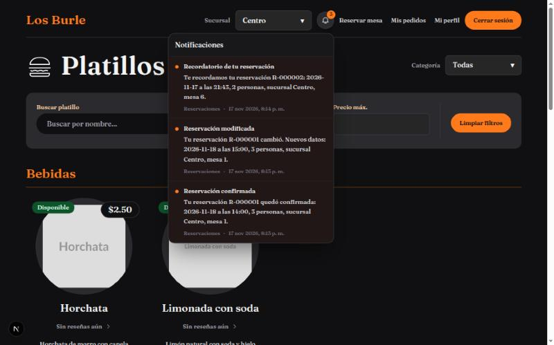
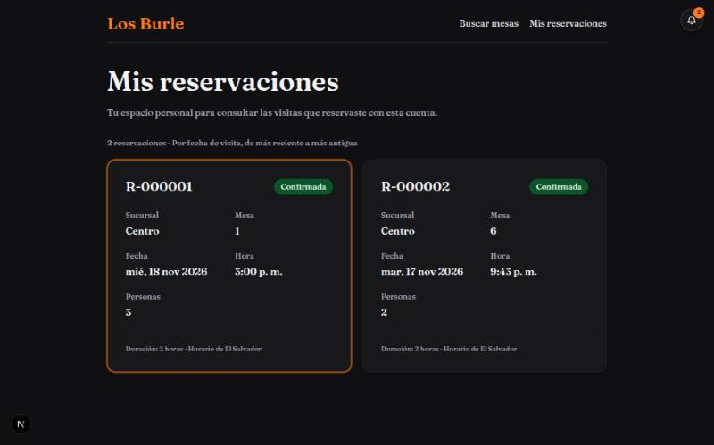
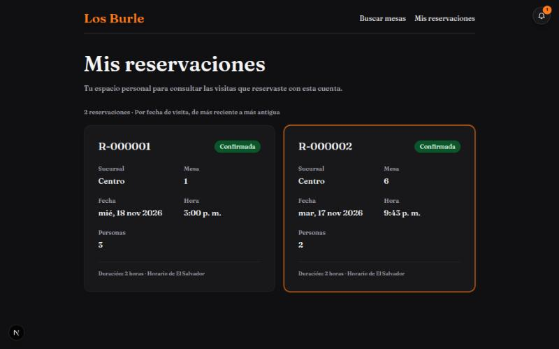

### Pagos

#### Procesar un pago para llevar (cliente)

1. Iniciar sesión como cliente y entrar al **Menú**.
2. Seleccionar los platillos y agregarlos al carrito con sus respectivas cantidades.
3. Revisar el carrito y verificar los platillos, cantidades y el total del pedido.
4. Seleccionar **Confirmar y pagar** para continuar con la compra.
5. Ingresar los datos de la tarjeta en el formulario de pago.
6. Confirmar la operación para iniciar el procesamiento del pago.
7. Esperar el resultado de la transacción. Si el pago es aprobado, se confirma la compra y el pedido continúa su preparación. Si es rechazado, se informa al cliente.
8. Consultar el estado del pedido desde **Mis pedidos**.

#### Procesar un pago de mesa (mesero)

1. Iniciar sesión como mesero y acceder a la sección de pedidos de mesa.
2. Seleccionar la mesa correspondiente al pedido que se desea cobrar.
3. Verificar que el pedido se encuentre en el estado requerido para permitir el cobro.
4. Abrir la opción de pago y revisar los platillos consumidos, sus cantidades y el total.
5. Seleccionar el método de pago: **Efectivo** o **Tarjeta**.
6. Si se selecciona **Efectivo**, ingresar la cantidad recibida del cliente. El sistema calcula automáticamente el cambio correspondiente.
7. Si se selecciona **Tarjeta**, ingresar los datos solicitados y procesar la operación mediante la pasarela simulada.
8. Confirmar el pago y esperar el resultado de la operación.
9. Si el pago se confirma correctamente, el sistema registra la transacción y permite consultar el comprobante.
10. Si el pago es rechazado, se informa del problema para realizar una nueva operación válida.

### Comprobantes de pago

#### Generar y descargar un comprobante de pago (cliente o mesero)

1. Completar el proceso de pago de un pedido para llevar o de mesa.
2. Una vez confirmado el pago, seleccionar la opción de consultar el comprobante.
3. Abrir el comprobante para visualizar los datos de la transacción.
4. Revisar el número de comprobante, fecha de emisión, sucursal, número de pedido y referencia de la transacción.
5. Verificar el desglose de platillos, cantidades, precios unitarios, subtotales y total pagado.
6. En pagos de mesa realizados en efectivo, consultar el monto recibido y el cambio, cuando estén disponibles.
7. Seleccionar **Descargar PDF** para guardar el comprobante.
8. El documento emitido al confirmar el pago se identifica como **ORIGINAL** y las descargas posteriores como **COPIA**.

### Beneficios

#### Consultar y gestionar beneficios (gerente o gerente general)

1. Iniciar sesión como gerente o gerente general y abrir **Beneficios**.
2. Revisar el catálogo de beneficios registrados, con su información, costo en puntos y período de vigencia.
3. Seleccionar la opción de agregar un beneficio para abrir el formulario de registro.
4. Completar los datos del descuento, costo en puntos, fecha de inicio y fecha de finalización de su vigencia.
5. Confirmar la creación para guardar el beneficio.
6. Para modificar un beneficio existente, seleccionarlo en el listado y abrir **Editar**.
7. Actualizar los datos permitidos y guardar los cambios.
8. Para retirar un beneficio, seleccionar **Deshabilitar** y confirmar la operación. La deshabilitación es definitiva y conserva el historial.
9. Los beneficios que superen su fecha de finalización dejan de estar disponibles para nuevas adquisiciones.
10. Los beneficios disponibles pueden ser adquiridos por clientes de cualquier sucursal.

#### Configurar la regla de acumulación de puntos (gerente o gerente general)

1. Iniciar sesión como gerente o gerente general y acceder a la administración de beneficios.
2. Consultar la regla vigente de acumulación de puntos por dólar.
3. Utilizar el campo numérico o los botones **+** y **-** para modificar la cantidad de puntos, dentro del rango de 1 a 10.
4. Seleccionar **Confirmar** para guardar la nueva regla.
5. Si no se desea aplicar el cambio, seleccionar **Deshacer** para restaurar el valor anterior.
6. La nueva regla se aplica a futuras acumulaciones sin modificar los puntos obtenidos anteriormente.

#### Consultar y adquirir beneficios (cliente)

1. Iniciar sesión como cliente y abrir **Mis beneficios**.
2. Consultar el saldo de puntos disponibles.
3. Seleccionar **Comprar beneficios**, ubicado junto al saldo de puntos.
4. Revisar el catálogo de descuentos disponibles, sus costos en puntos y condiciones de vigencia.
5. Seleccionar el beneficio que desea adquirir.
6. Verificar que cuenta con suficientes puntos para completar la adquisición.
7. Confirmar la operación. El sistema descuenta los puntos correspondientes del saldo.
8. El beneficio adquirido aparece en la pestaña **Beneficios pendientes**.
9. Seleccionar el beneficio para consultar su código de canje.

#### Consultar y presentar beneficios adquiridos (cliente)

1. Iniciar sesión como cliente y abrir **Mis beneficios**.
2. Seleccionar **Beneficios pendientes** para consultar los descuentos adquiridos que aún no han sido utilizados.
3. Elegir el beneficio que desea presentar al mesero.
4. Se abre una ventana emergente con el código de canje y el correo electrónico asociado a la cuenta del cliente.
5. Mostrar el correo electrónico y el código al mesero para verificar el beneficio.
6. El código tiene una vigencia de 5 minutos desde su generación.
7. Una vez confirmado el consumo por el mesero, el beneficio pasa a **Beneficios consumidos**.
8. Seleccionar **Beneficios consumidos** para consultar el historial de beneficios utilizados.

#### Verificar y confirmar un beneficio (mesero)

1. Iniciar sesión como mesero y acceder al panel principal.
2. Seleccionar **Canje de puntos**, ubicado junto a **Registrar pedido**.
3. Solicitar al cliente el correo electrónico de su cuenta y el código de canje de su beneficio.
4. Ingresar el correo electrónico y el código en el formulario de verificación.
5. Seleccionar la opción de verificar el beneficio.
6. El sistema comprueba que el código existe, corresponde al beneficio adquirido, no ha expirado y no ha sido utilizado anteriormente.
7. Si la información es válida, se muestra el beneficio correspondiente para su revisión.
8. Seleccionar **Confirmar** para registrar el consumo del beneficio.
9. El sistema registra la utilización e impide que el mismo código vuelva a utilizarse.
10. Si el código es inválido, está vencido o ya fue utilizado, el sistema rechaza la operación.
11. Para regresar al panel principal, seleccionar el logotipo del restaurante ubicado en la esquina superior izquierda.
