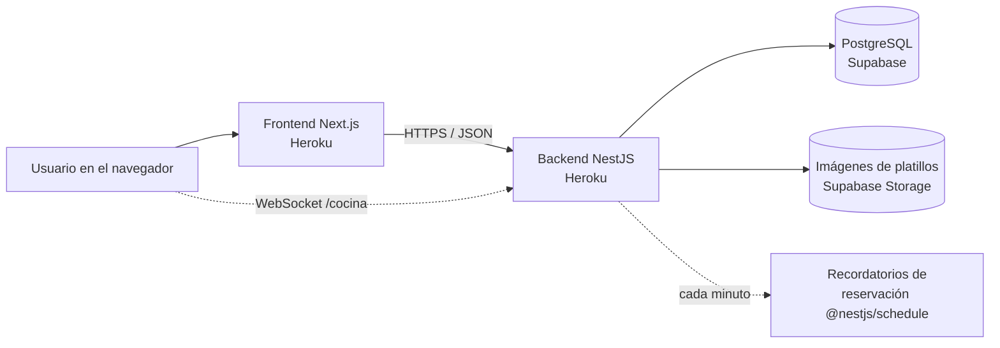

# Arquitectura

## Vista general



## Stack

| Capa | Tecnología | Versión |
|---|---|---|
| Frontend | Next.js, React, Tailwind CSS, Ariakit, socket.io-client | 16.3, 19.2, 4, 0.4, 4.8 |
| Backend | NestJS, Prisma ORM (driver adapter `pg`), Socket.IO, Swagger | 12, 7, 4.8, 12 |
| Lenguaje | TypeScript (ESM) | 6 en backend, 5 en frontend |
| Base de datos | PostgreSQL | 18 |
| Pruebas | Vitest (unitarias y e2e), oxlint en backend, ESLint en frontend | 4 |
| Contenedores | Docker y docker-compose, Node.js 24 (imagen Alpine) | |
| Generación de comprobantes | PDFKit | 0.20.2 |

## Estructura de carpetas

Backend (`be_boilerplate_is_2026`):

```
├── prisma/            schema.prisma, migrations/, seed.ts, destinos-base.ts (a qué base puede conectarse cada comando)
├── src/
│   ├── auth/          login, refresh, logout, guards y decoradores de roles
│   ├── users/         registro de usuarios
│   ├── menu/          menú público por sucursal
│   ├── platillos/     gestión de platillos e imágenes
│   ├── categorias/    gestión de categorías
│   ├── pedidos/       pedidos de mesa y para llevar
│   ├── cocina/        tablero, marcar listo, gateway Socket.IO
│   ├── mesero/        platillos listos por entregar y marcar entregado
│   ├── inventario/    insumos, movimientos, historial y alertas de insumos por agotarse
│   ├── reservaciones/ mesas disponibles y reservaciones
│   ├── resenas/       reseñas: consultar, calificar, reporte de calificaciones y moderación
│   ├── notificaciones/ servicio común de avisos, historial y envío de correo
│   ├── dashboard/     ventas por sucursal
│   ├── common/        paginación común (PaginacionQueryDto, paginar) y pipes compartidos
│   └── config/        validación de variables de entorno
├── test/              pruebas e2e
├── uploads/           imágenes en desarrollo local (sin Supabase Storage)
├── certs/             certificado CA de Supabase
├── scripts/           verificar-conexion.ts (npm run db:verificar)
├── Dockerfile
├── heroku.yml         build, release (migraciones) y arranque en Heroku
└── docker-compose.yml
```

Frontend (`fe_boilerplate_is_2026`):

```
├── app/               rutas: menu, login, reservas, pedidos, mesero (pedidos, entregas), cocina, admin (incluye inventario y alertas), dashboard (general y comparativo), perfil
│   └── actions/       Server Actions que llaman a la API
├── components/        componentes por módulo (menu, platillos, categorias, pedidos, resenas, notificaciones, ...)
│   └── ui/            componentes compartidos (paginación, modal, toast, drawer, ...)
├── lib/               acceso a la API, sesión y utilidades
├── proxy.ts           protección de rutas por sesión y rol
└── test/              pruebas con Vitest y Testing Library
```

Cada módulo del backend sigue el mismo patrón por capas: controlador (HTTP y validación de roles) → servicio (reglas de negocio) → repositorio (acceso a Prisma).

## Decisiones técnicas

| Decisión | Alternativas consideradas | Motivo |
|---|---|---|
| Access token JWT de vida corta (15 min) más refresh token opaco rotativo | Sesiones en servidor; JWT de larga duración | El JWT no requiere estado en el servidor; el refresh token se guarda como hash SHA-256, se canjea una sola vez de forma atómica y su reúso cierra la sesión. |
| Token de sesión del frontend en cookie `httpOnly` que vence junto con el access token | `localStorage` | El JavaScript del navegador no puede leer la cookie, lo que reduce el riesgo ante XSS. |
| Control de acceso por rol con guard global y decorador `@Roles` | Verificar el rol dentro de cada servicio | La regla queda visible en cada endpoint y todo lo no marcado como público exige autenticación. |
| Los platillos son globales y su precio, disponibilidad y estado (habilitado o no) viven por sucursal en `platillo_sucursal` | Duplicar el platillo en cada sucursal | Permite compartir un platillo entre sucursales sin que deshabilitarlo en una afecte a las demás. |
| Descuento de disponibilidad con bloqueo de fila (`SELECT ... FOR UPDATE`) dentro de una transacción | Validar en memoria antes de escribir | Evita vender de más cuando dos pedidos o ediciones llegan al mismo tiempo. |
| Socket.IO para el tablero de cocina, con una sala por sucursal y el access token en el handshake | Consultar la API cada pocos segundos | Los pedidos aparecen al instante y sin tráfico innecesario; cada cliente solo recibe los eventos de su sucursal. Al reconectar, el tablero recarga la lista completa para no perder pedidos. |
| Marcar un platillo como listo o entregado con bloqueo de fila y emitir los eventos después del commit | Actualizar sin bloqueo | Si dos personas marcan el mismo platillo a la vez, solo una lo logra y la otra recibe `409`; los eventos nunca anuncian un cambio que no se guardó. |
| Movimientos de inventario en una sola transacción con bloqueo de fila sobre el insumo | Calcular la existencia en memoria | La existencia nunca queda negativa aunque lleguen dos salidas al mismo tiempo; la salida que excede responde `422` sin cambiar la cantidad. |
| Alertas de insumos con índice único parcial `(insumo_id) WHERE estado <> 'RESUELTA'` y evaluación dentro de la transacción del movimiento | Revisar los insumos con una tarea programada | Nunca hay dos alertas abiertas para el mismo insumo; la alerta se crea o se resuelve en el mismo momento del movimiento y el correo se envía con el servicio común de avisos. |
| Despliegue en Heroku: backend como contenedor Docker (`heroku.yml`) y frontend como app Node.js | Vercel para el frontend y otro proveedor para la API | Las dos apps se publican y configuran en el mismo lugar; la fase *release* aplica las migraciones antes de publicar y, si fallan, la versión nueva no sale. |
| Imágenes de platillos en Supabase Storage (bucket `SUPABASE_BUCKET_PLATILLOS`); en local, si no hay credenciales de Supabase, se guardan en disco (`UPLOADS_DIR`) | Guardarlas siempre en el disco del contenedor | En Heroku el disco del contenedor no es permanente y las imágenes se perdían al reiniciar o redesplegar. El servicio de imágenes usa una interfaz común con dos implementaciones (Supabase y local). |
| Servicio común de avisos (`NotificacionesService.notificar`) que usan todos los módulos | Que cada módulo guarde sus propias notificaciones | Un solo lugar valida el aviso, resuelve los destinatarios por usuario, rol o sucursal y guarda el historial. Una clave única (módulo, referencia, destinatario) evita avisos duplicados aunque el proceso se repita. |
| El aviso se registra dentro de la transacción del cambio y el correo se envía después del commit | Enviar el correo en el mismo momento del cambio | Si la transacción falla no se avisa de algo que no pasó; el correo queda PENDIENTE y se reintenta hasta 3 veces. |
| Recordatorios de reservación con una tarea programada cada minuto (`@nestjs/schedule`) | Un servicio externo de colas o cron del sistema | No necesita infraestructura extra. El aviso se registra antes de marcar la reservación como recordada, así un fallo se reintenta en la siguiente pasada sin duplicar el aviso. |
| Aviso de pedido listo por evento interno (`EventEmitter2`, evento de cocina `pedido:listo`) | Llamar al módulo de notificaciones desde cocina | Cocina no depende de notificaciones; el mismo evento alimenta el tablero en tiempo real y el aviso al cliente. |
| Ocultar una reseña con una actualización condicionada a `estado = VISIBLE` | Leer el estado y después actualizar | Si dos gerentes ocultan la misma reseña a la vez, solo uno lo logra y el otro recibe `409 Esta reseña ya estaba oculta.` |
| Paginación común en backend (`PaginacionQueryDto` y `paginar`) y un componente `Paginacion` en el frontend | Que cada listado implemente su propia paginación | Los listados reciben `pagina` con la misma validación (1 a 1000) y responden `{ datos, pagina, totalPaginas, total }`; el frontend muestra las flechas y la página actual con un solo componente. |
| Restricciones `CHECK` en la base de datos y vista `venta_confirmada` para los reportes | Validar solo en la aplicación | La base rechaza datos inválidos (montos o precios en cero, estrellas fuera de 1 a 5, más de un pago activo por pedido) aunque falle una validación del código. |
| El ticket promedio y el total general se calculan en el backend (`GET /dashboard/ventas`) | Calcularlos en el frontend | El dashboard (H28), el comparativo (H29) y el CSV muestran el mismo valor. Los montos se suman en centavos enteros para evitar errores de redondeo. |
| Los periodos del dashboard son días completos en hora de El Salvador (UTC−6) | Filtrar por fechas UTC | Una venta de las 7 p. m. pertenece a ese día y no al siguiente, como la ve el negocio. |
| El comparativo (H29) reutiliza `GET /dashboard/ventas` y calcula el promedio y las alertas en el frontend | Un endpoint nuevo para el comparativo | No duplica la lógica de qué cuenta como venta. La alerta usa el promedio de las sucursales elegidas y compara en centavos ("más de 20 % por debajo"). |
| Las sucursales del dashboard y del comparativo vienen de `GET /sucursales` | Una lista fija en el frontend | Una sucursal nueva aparece en los filtros sin cambiar código. |
| Base compartida en Supabase con dos URLs: `DATABASE_URL` (transaction pooler, 6543) para la API y `DIRECT_URL` (session pooler, 5432) para el CLI de Prisma | Una sola URL; base local por integrante | El transaction pooler soporta muchas conexiones a la vez; las migraciones necesitan el session pooler. Todo el equipo trabaja con los mismos datos. |
| La conexión de la API valida el certificado de Supabase (`sslmode=verify-full`) | `sslmode=no-verify` | Cifra la conexión y comprueba que el servidor es el de Supabase. |
| Los comandos que borran datos (`migrate dev`, `migrate reset`, `db push`, `db execute`) y las pruebas e2e solo corren contra un Postgres local | Confiar en que nadie los corra contra Supabase | `prisma.config.ts` y `vitest.config.e2e.ts` validan el destino antes de conectarse y fallan si no es `localhost`, `127.0.0.1` o `::1`. |
| Las pruebas e2e que necesitan una base exclusiva (H10, H11, H17) corren en proyectos de Vitest con su propia base temporal | Omitirlas y correrlas a mano | Un solo `npm run test:e2e` corre todo; cada base temporal se crea y se migra sola. |
