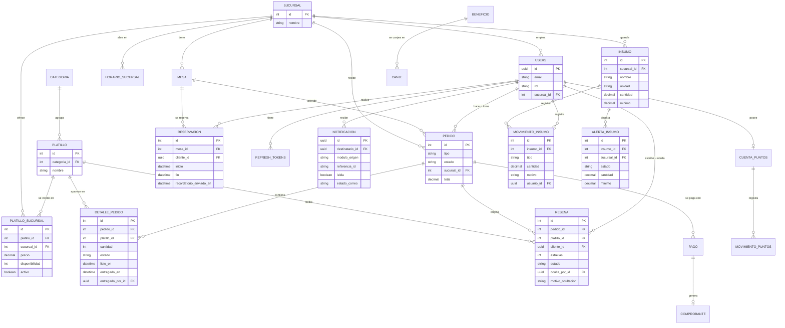

# Modelo de datos

## Diagrama entidad-relación

## Tablas

| Tabla | Descripción | Campos importantes |
|---|---|---|
| `users` | Cuentas del sistema, una por persona, con su rol y, para el personal, su sucursal. | `email` único, `password_hash`, `rol` (CLIENTE, MESERO, COCINA, GERENTE, GERENTE_GENERAL), `sucursal_id` |
| `refresh_tokens` | Refresh tokens emitidos; se guarda solo el hash. | `token_hash`, `expires_at`, `revoked_at` |
| `sucursal` | Sucursales del restaurante. | `nombre` único, `direccion` |
| `horario_sucursal` | Horario de atención por día de la semana. | `dia_semana`, `apertura`, `cierre` |
| `mesa` | Mesas de una sucursal. | `numero` (único por sucursal), `capacidad`, `zona`, `activa` |
| `categoria` | Categorías del menú. | `nombre`, `activa` |
| `platillo` | Platillo del catálogo, compartido entre sucursales. | `categoria_id`, `nombre`, `descripcion`, `imagen_url` |
| `platillo_sucursal` | Precio, disponibilidad y estado de un platillo en una sucursal. | `precio`, `disponibilidad`, `activo`; único por platillo y sucursal |
| `pedido` | Pedido de mesa o para llevar. | `tipo` (MESA, LLEVAR), `estado`, `sucursal_id`, `mesa_id`, `cliente_id`, `mesero_id`, totales |
| `detalle_pedido` | Platillos de un pedido. | `cantidad`, `precio_unitario`, `nota`, `estado` (PENDIENTE, LISTO, ENTREGADO), `listo_en`, `entregado_en`, `entregado_por_id` (mesero que lo entregó) |
| `reservacion` | Reservación de una mesa por 2 horas. | `mesa_id`, `cliente_id`, `inicio`, `fin`, `estado`, `recordatorio_enviado_en` (marca el recordatorio de 2 horas antes para no repetirlo) |
| `pago` | Pagos de un pedido, con clave de idempotencia. | `idempotency_key`, `monto`, `estado` |
| `comprobante` | Comprobante emitido por un pago confirmado. | `numero`, `transaccion_id` |
| `resena` | Reseña de un platillo de un pedido pagado del cliente; una por platillo y pedido. | `pedido_id` + `platillo_id` únicos, `estrellas` (1 a 5, con CHECK), `comentario` (máx. 500), `estado` (VISIBLE, OCULTA), `oculta_por_id`, `oculta_en`, `motivo_ocultacion` (OFENSIVO, SPAM, NO_RELACIONADO), `creada_en` |
| `notificacion` | Historial de avisos por usuario, generado por el servicio común de avisos. | `titulo`, `mensaje`, `modulo_origen`, `referencia_tipo` y `referencia_id` (a qué pantalla lleva), `leida`, `leida_en`, `estado_correo` (PENDIENTE, ENVIADO, FALLIDO), `intentos_correo`; único por módulo, referencia y destinatario para no duplicar avisos |
| `insumo` | Insumos clave por sucursal. | `sucursal_id`, `nombre` (único por sucursal sin distinguir mayúsculas), `unidad` (LB, KG, L, UNIDAD), `cantidad` y `minimo` (decimales, no negativos) |
| `movimiento_insumo` | Entradas y salidas de un insumo; cada una actualiza la existencia en la misma transacción. | `tipo` (ENTRADA, SALIDA), `cantidad` (mayor a 0), `cantidad_anterior`, `cantidad_actual`, `motivo`, `usuario_id`, `creado_en`; índice por insumo y fecha descendente |
| `alerta_insumo` | Alertas cuando un insumo llega a su mínimo o queda debajo. | `sucursal_id`, `estado` (ACTIVA, VISTA, RESUELTA), `cantidad` y `minimo` al crearse, `creada_en`, `vista_en`, `resuelta_en`; índice único parcial que permite una sola alerta sin resolver por insumo |
| `cuenta_puntos`, `regla_puntos`, `beneficio`, `canje`, `movimiento_puntos`, `historial_lealtad` | Programa de lealtad: saldo de puntos, reglas de acumulación, beneficios canjeables y su historial. | `saldo`, `puntos_por_dolar`, `costo_puntos` |

## Vistas y restricciones

- **Vista `venta_confirmada`:** una fila por pedido con pago confirmado (pedido, sucursal, fecha del pago y monto neto: subtotal menos descuentos, sin IVA ni propina). La usan el dashboard de ventas (H28) y el comparativo (H29) para no repetir la lógica de qué cuenta como venta; además excluyen los pedidos con un pago reembolsado.
- **Índice único parcial en `alerta_insumo`:** `(insumo_id) WHERE estado <> 'RESUELTA'`, para que no haya dos alertas abiertas del mismo insumo.
- **Restricciones `CHECK`:** precios y montos de pago mayores a cero, cantidades y disponibilidad no negativas, totales del pedido no negativos, estrellas de 1 a 5, rango de reservación válido (`fin > inicio`), día de la semana de 0 a 6, y reglas del programa de lealtad (saldo no negativo, puntos por dólar de 1 a 10).
- **Un solo pago activo por pedido** y el comprobante ligado a su pago con una llave foránea compuesta (transacción y pedido).
